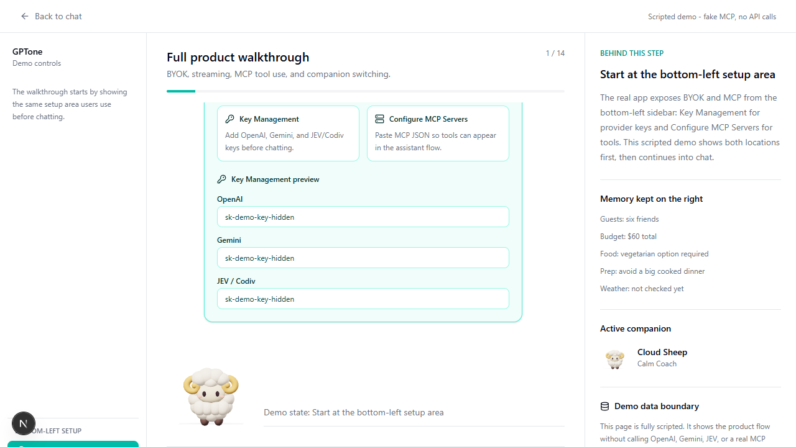
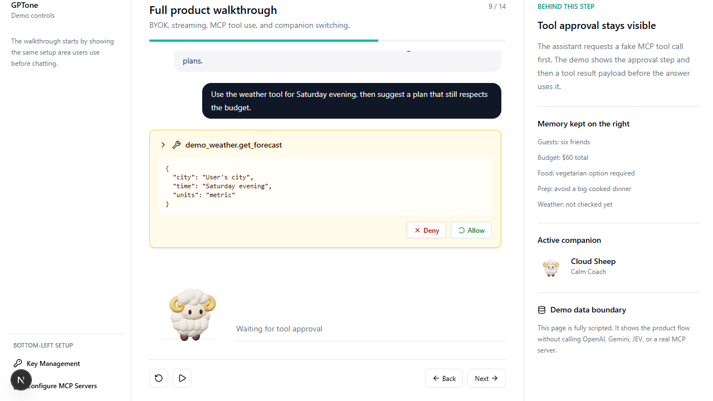
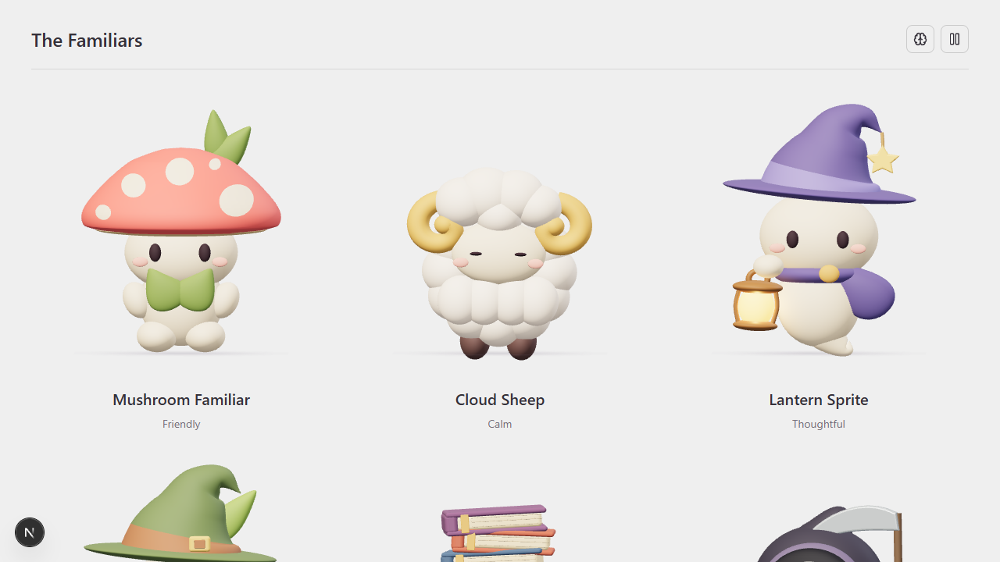

# GPTone Companion Chat

GPTone is a full-stack AI companion chat application for experimenting with
personality, memory, tool use, and user-owned model access. It combines a
streaming LangGraph agent with animated companion characters, BYOK provider
keys, MCP tool configuration, JEV/Codiv persona recommendations, private
per-user thread ownership, Postgres persistence, and S3-compatible file storage.

The project is designed to feel like a real product rather than a plain chatbot:
the user can choose a companion, keep a conversation thread alive, attach tools,
switch communication style mid-thread, and still preserve factual continuity.



## Highlights

- **Companion-first chat** - animated characters map to backend personas such as
  calm coaching, technical analysis, creative ideation, review, and celebration.
- **Streaming responses** - the frontend consumes Server-Sent Events and renders
  incremental assistant chunks instead of waiting for a full answer.
- **BYOK provider keys** - users can add OpenAI, Gemini, and JEV/Codiv keys from
  the app UI, with optional server-side fallback keys for hosted demos.
- **MCP tool configuration** - users can paste MCP JSON, enable HTTP or stdio
  servers, inspect available tools, and approve tool calls during chat.
- **JEV/Codiv companion switching** - the app can classify the user's current
  intent and recommend a better companion while carrying over a neutral summary.
- **Private thread ownership** - thread lists and history are scoped with an
  anonymous owner cookie so one visitor does not see another visitor's threads.
- **Persistent agent memory** - LangGraph checkpointing keeps message history
  across reloads and thread navigation.
- **File upload pipeline** - uploads are stored in S3-compatible storage, so the
  same app can run locally with MinIO or in production with R2/S3.
- **Portfolio demo route** - `/demo` is a scripted, API-free walkthrough that
  shows BYOK, streaming, MCP setup, a fake tool call, and persona switching.

## Visual Tour

The demo starts by showing the real bottom-left setup area where users add BYOK
keys and MCP servers before chatting.


The same demo later shows a fake MCP weather tool call with approval UI, tool
arguments, memory on the right panel, and the active companion state.



Companions are selectable from the character gallery, and each companion maps to
a communication persona used by the backend prompt.



## Demo Talk Track

Use `/demo` when presenting the project. It is intentionally scripted and does
not call OpenAI, Gemini, JEV/Codiv, or a real MCP server.

1. **Start with setup** - the demo points at the bottom-left `Key Management`
   and `Configure MCP Servers` controls so viewers know where real setup lives.
2. **Add BYOK keys** - it previews OpenAI, Gemini, and JEV/Codiv key slots
   without exposing any real secret.
3. **Stream normal chat** - the first assistant messages type in gradually to
   demonstrate streaming behavior.
4. **Add MCP JSON** - the flow shows a weather MCP config being pasted and
   saved.
5. **Approve a tool call** - a fake `demo_weather.get_forecast` call appears
   with allow/deny controls and a structured result payload.
6. **Switch companion** - JEV recommends a creative companion; the app switches
   avatar/persona while preserving a neutral memory summary.

## Tech Stack

| Layer         | Choices                                                               |
| ------------- | --------------------------------------------------------------------- |
| App framework | Next.js App Router, React 19, TypeScript                              |
| UI            | Tailwind CSS, Radix primitives, lucide-react, Framer Motion           |
| Agent runtime | LangGraph.js, LangChain model adapters                                |
| Models        | OpenAI, Google Gemini, optional JEV/Codiv classifier                  |
| Tooling       | Model Context Protocol, LangChain MCP adapters                        |
| Persistence   | Postgres, Prisma, LangGraph Postgres checkpointer                     |
| Storage       | S3-compatible object storage, local MinIO, Cloudflare R2/AWS S3 ready |
| 3D/avatars    | Three.js, GLB assets, WebP character art                              |
| API docs      | OpenAPI route registry with Scalar viewer                             |

## Product Architecture

```mermaid
flowchart LR
  User[Browser user] --> UI[Next.js React UI]
  UI --> Keys[BYOK key state]
  UI --> SSE[/api/agent/stream]
  UI --> Threads[/api/agent/threads]
  UI --> MCPUI[/api/mcp-servers]
  UI --> Uploads[/api/agent/upload]

  SSE --> Agent[LangGraph agent]
  Agent --> Prompt[Persona prompt builder]
  Agent --> Models[OpenAI or Gemini]
  Agent --> Tools[MCP tools]
  Agent --> Memory[LangGraph checkpoints]

  Threads --> Prisma[Prisma]
  MCPUI --> Prisma
  Uploads --> S3[S3 / R2 / MinIO]
  Prisma --> Postgres[(Postgres)]
  Memory --> Postgres
  Tools --> MCP[(HTTP or stdio MCP servers)]
```

### Request Flow

1. The user selects a companion and sends a message from the chat UI.
2. The frontend posts to `/api/agent/stream` with the thread id, user text,
   selected persona, and any BYOK provider keys.
3. The route resolves the anonymous thread owner cookie and starts a streaming
   response.
4. `streamResponse` ensures the thread belongs to that owner, builds the
   persona-aware LangGraph agent, loads enabled MCP tools, and streams chunks.
5. The frontend buffers and renders message chunks as they arrive, including
   tool calls, tool results, errors, and final completion events.

## Core Features

### BYOK Key Management

GPTone is built for user-owned model access. The browser UI exposes provider
slots for:

- `OPENAI_API_KEY`
- `GOOGLE_API_KEY`
- `CODIV_API_KEY`
- `CODIV_BASE_URL`
- `CODIV_MODEL`

Keys entered in the UI are used for the matching provider request. Hosted demos
can also define optional server fallback keys in `.env`, which keeps the app
usable when the presenter wants a zero-setup walkthrough.

### MCP Tool Use

MCP servers are configured from the left panel with JSON similar to:

```json
{
  "mcpServers": {
    "demo_weather": {
      "transport": "http",
      "url": "https://demo.local/mcp/weather",
      "headers": {
        "Authorization": "Bearer demo-token"
      }
    }
  }
}
```

The app supports both `http` and `stdio` MCP server records. Enabled servers are
loaded by the LangGraph agent, exposed in the UI, and can request approval before
execution.

### Persona Switching

Companion switching has two parts:

- `suggest-switch` classifies the current user message against companion
  criteria and returns a confidence score.
- `summarize-switch` creates a neutral factual summary so the new persona gets
  context without inheriting the old persona's tone.

That separation lets GPTone change communication style without losing the facts
already established in the thread.

### Thread Privacy

Threads are scoped by `ownerId`. The backend issues an anonymous
`gptone_owner_id` cookie and applies it when listing, creating, updating,
deleting, streaming, or fetching history. This keeps public-demo visitors from
seeing each other's thread lists.

## Database Schema

Prisma owns the product metadata tables. LangGraph also creates checkpoint
tables in Postgres for message memory.

```prisma
model Thread {
  id        String   @id @default(uuid())
  ownerId   String   @default("legacy")
  title     String
  personaId String   @default("efficient")
  createdAt DateTime @default(now())
  updatedAt DateTime @updatedAt

  @@index([ownerId, updatedAt])
}

model MCPServer {
  id            String        @id @default(uuid())
  name          String        @unique
  type          MCPServerType
  enabled       Boolean       @default(true)
  command       String?
  args          Json?
  env           Json?
  url           String?
  headers       Json?
  requiresAuth  Boolean?      @default(false)
  authTokens    Json?
  clientInfo    Json?
  codeVerifier  String?
  oauthStatus   String?       @default("UNKNOWN")
  createdAt     DateTime      @default(now())
  updatedAt     DateTime      @updatedAt
}

enum MCPServerType {
  stdio
  http
}
```

### Storage Responsibilities

| Store                       | Used for                                              |
| --------------------------- | ----------------------------------------------------- |
| `Thread`                    | User-owned thread metadata, title, active persona     |
| `MCPServer`                 | Tool server configuration, OAuth status, headers, env |
| LangGraph checkpoint tables | Message state, tool state, resumable agent history    |
| S3/R2/MinIO bucket          | Uploaded files and attachment content                 |

## Route Map

| Route                           | Purpose                                                 |
| ------------------------------- | ------------------------------------------------------- |
| `/`                             | Main chat application                                   |
| `/thread/[threadId]`            | Persisted thread view                                   |
| `/characters`                   | Companion selection gallery                             |
| `/demo`                         | Scripted portfolio walkthrough                          |
| `/api-docs`                     | Scalar OpenAPI explorer                                 |
| `/api/agent/stream`             | SSE chat streaming endpoint                             |
| `/api/agent/threads`            | List, create, rename, delete, and update thread persona |
| `/api/agent/history/[threadId]` | Fetch LangGraph message history                         |
| `/api/agent/upload`             | Upload files to S3-compatible storage                   |
| `/api/agent/files`              | Read uploaded file content                              |
| `/api/mcp-servers`              | Manage MCP server configuration                         |
| `/api/mcp-tools`                | List currently available MCP tools                      |
| `/api/persona/suggest-switch`   | Recommend a better companion/persona                    |
| `/api/persona/summarize-switch` | Generate neutral context for persona handoff            |
| `/api/oauth/*`                  | Optional OAuth flow for HTTP MCP servers                |

## Local Development

Install dependencies:

```bash
pnpm install
```

Create an environment file:

```bash
cp .env.example .env
```

Start Postgres and MinIO:

```bash
docker compose up -d
```

Create the local upload bucket when needed:

```bash
docker compose --profile setup up createbuckets
```

Generate Prisma client and run migrations:

```bash
pnpm prisma:generate
pnpm prisma:migrate
```

Run the app:

```bash
pnpm dev
```

Open:

```text
http://localhost:3000
```

## Environment Variables

Required for local persistence:

```bash
DATABASE_URL=
S3_ENDPOINT=
S3_ACCESS_KEY_ID=
S3_SECRET_ACCESS_KEY=
S3_BUCKET_NAME=
S3_REGION=
S3_FORCE_PATH_STYLE=
```

Optional model fallbacks:

```bash
OPENAI_API_KEY=
GOOGLE_API_KEY=
CODIV_API_KEY=
CODIV_BASE_URL=
CODIV_MODEL=
```

Useful local ports:

```bash
PORT=3000
POSTGRES_PORT=5434
S3_API_PORT=9000
S3_CONSOLE_PORT=9001
```

## Deployment Notes

GPTone is designed for Vercel-style deployment:

- Use Neon, Supabase, or another managed Postgres database for `DATABASE_URL`.
- Use Cloudflare R2, AWS S3, or another S3-compatible bucket for uploaded files.
- Keep server fallback model keys optional if the public demo should be BYOK-only.
- Run Prisma migrations before serving production traffic.
- Preserve `NEXT_PUBLIC_APP_URL` and `NEXT_PUBLIC_API_BASE_URL` for the deployed
  domain.

For production migrations:

```bash
pnpm exec prisma migrate deploy
```

## Scripts

| Command                | Purpose                                  |
| ---------------------- | ---------------------------------------- |
| `pnpm dev`             | Start Next.js with Turbopack             |
| `pnpm build`           | Generate Prisma client and build the app |
| `pnpm start`           | Serve the production build               |
| `pnpm prisma:generate` | Generate Prisma client                   |
| `pnpm prisma:migrate`  | Run local Prisma migrations              |
| `pnpm prisma:studio`   | Open Prisma Studio                       |
| `pnpm format`          | Format the repository                    |
| `pnpm format:check`    | Check formatting                         |

## Repository Notes

- The project is private by default in `package.json`; rename and publish only
  when you are ready.
- Screenshot assets for this README live in `public/readme/`.
- Third-party assets under `public/momo` and `public/draco` keep their original
  notices.
- LangGraph checkpoint tables are managed by the checkpointer and may not appear
  in `prisma/schema.prisma`.

## License And Attribution

## License

GPTone is an independently developed AI application. The product identity, companion UX, BYOK flow, JEV/Codiv switching, demo experience, thread privacy enhancements, documentation, and deployment adaptations are original project contributions.

Certain portions of the codebase are derived from third-party open-source software and remain subject to their respective licenses. See the applicable license notices for details.
